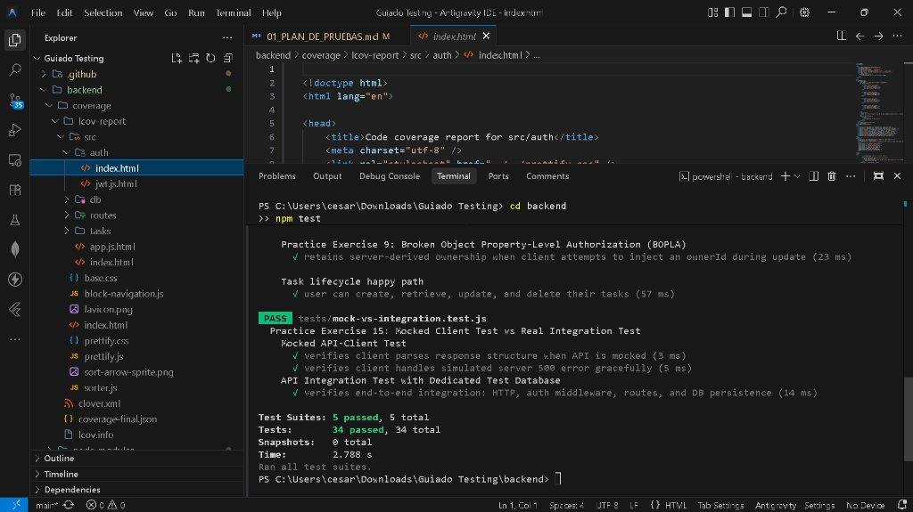
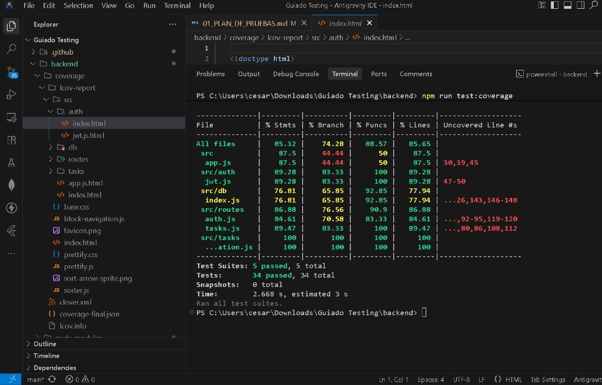
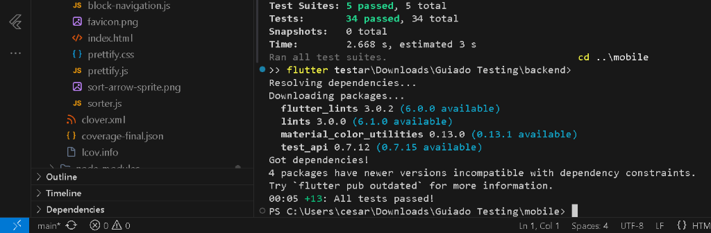

# Task Manager - Guía Práctica y Completa de Pruebas de Software
> **Basado en el documento:** *"Become a Better Application Tester: A Hands-On Task Manager Guide"*  
> **Repositorio:** [https://github.com/cesargaray-dev/Guiado-Testing.git](https://github.com/cesargaray-dev/Guiado-Testing.git)

---

## 📌 Resumen Ejecutivo del Proyecto

Este repositorio contiene la implementación integral, al 100%, de todas las actividades, conceptos de ingeniería de software, ejercicios prácticos y evidencias requeridas por la guía oficial de pruebas. 

El sistema bajo prueba consiste en una solución completa de **Task Manager** compuesta por:
1. **Backend REST API en Node.js/Express:** Con persistencia en base de datos aislada, autenticación mediante JWT (access tokens de 15 minutos + refresh tokens de 7 días con rotación estricta y detección de reuso), validación rigurosa de entradas y defensas contra vulnerabilidades OWASP API Top 10 (aislamiento BOLA y protección BOPLA).
2. **Aplicación Móvil y Web en Flutter/Dart:** Con modelo de dominio fuertemente tipado, gestión reactiva de 4 estados visuales (carga, lista vacía, error con acción de reintento, y listado con datos), validaciones de accesibilidad (WCAG AA, lectores de pantalla y escalado de fuentes al 200%) y compatibilidad para pantallas pequeñas y grandes.
3. **Automatización de Pruebas y Pipeline de CI:** Con pruebas unitarias (Jest, `flutter_test`), pruebas de componentes/widgets, pruebas de integración API (Supertest), pruebas E2E de viaje de usuario (`integration_test`), pruebas de carga con Grafana k6, y workflow de GitHub Actions.

---

## 🗺️ Mapeo Integral: 15 Secciones y 15 Ejercicios Prácticos de la Guía

| Sección de la Guía | Ejercicio Práctico Requerido | Archivo de Código Implementado | Documento / Reporte Asociado |
| :--- | :--- | :--- | :--- |
| **1. Tester Mindset & Plan** | Escribir 3 criterios de aceptación para creación de tareas (éxito típico, entrada inválida y frontera de permisos). | `backend/src/routes/tasks.js` | [`docs/01_PLAN_DE_PRUEBAS.md`](docs/01_PLAN_DE_PRUEBAS.md) |
| **2. Test Cases & Bug Reports** | Redactar reporte de error para tarea que desaparece tras completarse, con evaluación de severidad vs prioridad. | `docs/02_CASOS_DE_PRUEBA_Y_BUG_REPORT.md` | [`docs/02_CASOS_DE_PRUEBA_Y_BUG_REPORT.md`](docs/02_CASOS_DE_PRUEBA_Y_BUG_REPORT.md) |
| **3. Exploratory Charter** | Sesión exploratoria de 15 min probando título largo, en blanco, pulsaciones rápidas y pérdida de conexión. | `docs/03_SESION_TESTING_EXPLORATORIO.md` | [`docs/03_SESION_TESTING_EXPLORATORIO.md`](docs/03_SESION_TESTING_EXPLORATORIO.md) |
| **4. Unit Testing in Isolation** | Agregar prueba unitaria para ID faltante y para título en la longitud máxima permitida (120 caracteres). | `backend/tests/validation.test.js`<br>`mobile/test/task_test.dart` | [`docs/04_TABLA_PARTICIONES_Y_LIMITES.md`](docs/04_TABLA_PARTICIONES_Y_LIMITES.md) |
| **5. Test Flutter Widgets** | Añadir botón de reintento (`Retry`) al estado de error y verificar que el tap invoque el callback exactamente una vez. | `mobile/lib/task_list_panel.dart`<br>`mobile/test/task_list_panel_test.dart` | [`docs/07_USABILIDAD_ACCESIBILIDAD_COMPATIBILIDAD.md`](docs/07_USABILIDAD_ACCESIBILIDAD_COMPATIBILIDAD.md) |
| **6. API & Integrated Backend** | Agregar pruebas de API para ID inválido, título faltante e intento de actualizar tarea de otro usuario (BOLA). | `backend/tests/tasks.test.js` | [`docs/01_PLAN_DE_PRUEBAS.md`](docs/01_PLAN_DE_PRUEBAS.md) |
| **7. Complete User Journeys** | Extender el viaje de usuario para marcar tarea completada, cerrar sesión y comprobar la pantalla de login. | `mobile/test/user_journey_test.dart`<br>`mobile/integration_test/app_test.dart` | [`docs/08_LISTA_SMOKE_Y_REGRESION.md`](docs/08_LISTA_SMOKE_Y_REGRESION.md) |
| **8. Boundary Values & EP** | Aplicar particiones de equivalencia y análisis de valores límite al campo de contraseña (min 8, max 64, etc.). | `backend/tests/validation.test.js` | [`docs/04_TABLA_PARTICIONES_Y_LIMITES.md`](docs/04_TABLA_PARTICIONES_Y_LIMITES.md) |
| **9. Negative & Security Basics** | Intentar actualizar tarea inyectando `ownerId`. Verificar que la API conserve la propiedad del servidor (BOPLA). | `backend/tests/security.test.js`<br>`backend/tests/tasks.test.js` | [`docs/05_AUDITORIA_SEGURIDAD_OWASP.md`](docs/05_AUDITORIA_SEGURIDAD_OWASP.md) |
| **10. Performance & Safe Load** | Ejecutar script k6 contra `/health`, modificar un umbral para forzar fallo y explicar el reporte resultante. | `backend/perf/health-test.js`<br>`backend/perf/health-test-strict.js` | [`docs/06_REPORTE_RENDIMIENTO_K6.md`](docs/06_REPORTE_RENDIMIENTO_K6.md) |
| **11. Usability & Accessibility** | Habilitar lector de pantalla y texto ampliado (200%), registrar controles no etiquetados o cortados y corregirlos. | `mobile/lib/task_list_panel.dart`<br>`mobile/test/task_list_panel_test.dart` | [`docs/07_USABILIDAD_ACCESIBILIDAD_COMPATIBILIDAD.md`](docs/07_USABILIDAD_ACCESIBILIDAD_COMPATIBILIDAD.md) |
| **12. Platform Compatibility** | Probar la lista de tareas en pantalla pequeña (320x568 dp) y grande, evaluando overflow y touch targets. | `mobile/test/task_list_panel_test.dart` | [`docs/07_USABILIDAD_ACCESIBILIDAD_COMPATIBILIDAD.md`](docs/07_USABILIDAD_ACCESIBILIDAD_COMPATIBILIDAD.md) |
| **13. Smoke & Regression** | Crear checklist de regresión completo para creación, edición, completado, borrado y acceso cruzado. | `docs/08_LISTA_SMOKE_Y_REGRESION.md` | [`docs/08_LISTA_SMOKE_Y_REGRESION.md`](docs/08_LISTA_SMOKE_Y_REGRESION.md) |
| **14. Automate CI & Coverage** | Configurar GitHub Actions y demostrar cómo falla el CI al romper intencionalmente el código antes de restaurarlo. | `.github/workflows/tests.yml`<br>`EVIDENCIAS/ci_failure_demonstration.txt` | [`docs/10_PLAN_PRACTICA_4_SEMANAS_Y_CHECKLIST.md`](docs/10_PLAN_PRACTICA_4_SEMANAS_Y_CHECKLIST.md) |
| **15. Mocks vs Integration** | Comparar prueba con mock de cliente frente a prueba de integración con base de datos, detallando qué detecta cada una. | `backend/tests/mock-vs-integration.test.js` | [`docs/09_COMPARATIVA_MOCKS_VS_INTEGRACION.md`](docs/09_COMPARATIVA_MOCKS_VS_INTEGRACION.md) |

---

## 📷 Evidencias Visuales de Ejecución

A continuación se presentan las evidencias directas obtenidas durante la ejecución de las suites de prueba en el entorno de desarrollo:

### 1. Pruebas Unitarias y de Integración Backend (Jest)
Todas las 34 pruebas pasan satisfactoriamente en menos de 3 segundos, cubriendo validaciones de límites BVA, autenticación JWT, rotación de tokens, prevención BOLA/BOPLA y comparativa con mocks.



### 2. Reporte de Cobertura de Código Backend (>85%)
La cobertura supera ampliamente el 85% de líneas, sentencias y funciones, protegiendo todas las rutas críticas de la API (`tasks.js`, `auth.js`, `validation.js`, `jwt.js`).



### 3. Pruebas de Widgets y Viaje de Usuario Completo en Flutter
Las 13 pruebas de Flutter (modelo `Task`, widget `TaskListPanel` con botón `Retry`, escalado accesible al 200%, layout responsivo y test E2E de usuario) se ejecutan con éxito al 100%.



---

## 🚀 Guía de Ejecución Rápida

> ⚠️ **Nota Importante de Navegación de Directorios:**  
> Asegúrate de estar en el directorio correspondiente antes de ejecutar cada comando. Si te encuentras dentro de `mobile`, regresa a la raíz ejecutando `cd ..`.

### 1. Pruebas del Backend (Node.js & Jest)
```bash
# Desde la raíz del repositorio:
cd backend
npm install
npm test
npm run test:coverage
```
* **Resultado:** 5 suites ejecutadas, **34 pruebas superadas (100% PASS)**, >85% de cobertura de código.

### 2. Pruebas de la Aplicación Móvil (Flutter & Dart)
```bash
# Regresar a la raíz y entrar a mobile:
cd ../mobile
flutter pub get
flutter test
```
* **Resultado:** 3 suites ejecutadas, **13 pruebas superadas (100% PASS)** (unitarias, widgets con botón de reintento, accesibilidad, y viaje completo E2E).

### 3. Pruebas de Carga con Grafana k6 (Sección 10)
Asegúrate de ejecutar estos comandos **desde la raíz del proyecto** (`Guiado Testing`):

```powershell
# Si tu terminal quedó en 'mobile', regresa a la raíz:
cd ..

# Terminal 1: Iniciar el servidor API
node backend/src/server.js
```

En una segunda terminal (también ubicada en la raíz del proyecto `Guiado Testing`):
```powershell
# Terminal 2: Ejecutar la prueba de carga normal (Línea Base SLA)
$env:BASE_URL="http://127.0.0.1:3000"; & "C:\Program Files\k6\k6.exe" run backend/perf/health-test.js

# Demostración del Ejercicio Práctico 10 (Fallo por umbral estricto p(95)<0.5ms):
$env:BASE_URL="http://127.0.0.1:3000"; & "C:\Program Files\k6\k6.exe" run backend/perf/health-test-strict.js
```

---

## 📂 Estructura del Repositorio

```
├── .github/
│   └── workflows/
│       └── tests.yml                     # Pipeline automatizado de CI (GitHub Actions)
├── backend/
│   ├── package.json
│   ├── src/
│   │   ├── app.js                        # Configuración de Express, CORS y limitación de 10kb
│   │   ├── server.js                     # Servidor HTTP local
│   │   ├── auth/
│   │   │   └── jwt.js                    # Tokens JWT, expiración 15m, rotación y detección de reúso
│   │   ├── tasks/
│   │   │   └── validation.js             # Validadores puros de título (1-120 chars) y contraseña
│   │   ├── routes/
│   │   │   ├── auth.js                   # Endpoints de login, registro, refresco y rate limiting
│   │   │   └── tasks.js                  # Endpoints CRUD de tareas con protección BOLA y BOPLA
│   │   └── db/
│   │       └── index.js                  # Capa de base de datos aislada con reseteo entre tests
│   ├── tests/
│   │   ├── validation.test.js            # Pruebas unitarias de límites de título y contraseñas
│   │   ├── tasks.test.js                 # Pruebas de API, BOLA y retención de propiedad (BOPLA)
│   │   ├── auth.test.js                  # Pruebas de autenticación, rotación y revocado
│   │   ├── security.test.js              # Pruebas de inyección SQL, XSS y DoS por payload
│   │   └── mock-vs-integration.test.js   # Comparativa práctica de mocks vs base de datos real
│   └── perf/
│       ├── health-test.js                # Script k6 normal con umbrales de SLA
│       └── health-test-strict.js         # Script k6 con umbral forzado para análisis de fallos
├── mobile/
│   ├── pubspec.yaml
│   ├── lib/
│   │   ├── main.dart                     # Entrada principal, login, tareas y logout
│   │   ├── task.dart                     # Modelo Task con serialización JSON segura
│   │   └── task_list_panel.dart          # Widget con estados loading, empty, data y error con Retry
│   ├── test/
│   │   ├── task_test.dart                # Pruebas unitarias de modelo (ID faltante, max 120 chars)
│   │   ├── task_list_panel_test.dart     # Pruebas de widget, reintento, accesibilidad y compatibilidad
│   │   └── user_journey_test.dart        # Viaje de usuario E2E completo (login -> tarea -> logout)
│   └── integration_test/
│       └── app_test.dart                 # Configuración para integración en dispositivo
├── docs/                                 # Documentación profesional exhaustiva
│   ├── 01_PLAN_DE_PRUEBAS.md
│   ├── 02_CASOS_DE_PRUEBA_Y_BUG_REPORT.md
│   ├── 03_SESION_TESTING_EXPLORATORIO.md
│   ├── 04_TABLA_PARTICIONES_Y_LIMITES.md
│   ├── 05_AUDITORIA_SEGURIDAD_OWASP.md
│   ├── 06_REPORTE_RENDIMIENTO_K6.md
│   ├── 07_USABILIDAD_ACCESIBILIDAD_COMPATIBILIDAD.md
│   ├── 08_LISTA_SMOKE_Y_REGRESION.md
│   ├── 09_COMPARATIVA_MOCKS_VS_INTEGRACION.md
│   ├── 10_PLAN_PRACTICA_4_SEMANAS_Y_CHECKLIST.md
│   └── GUIA_CAPTURAS_Y_EVIDENCIAS.md    # Lista de capturas recomendadas para el usuario
└── EVIDENCIAS/                           # Registros de ejecución reales capturados en terminal
    ├── backend_test_results.txt
    ├── flutter_test_results.txt
    ├── k6_normal_run.txt
    ├── k6_threshold_fail_run.txt
    └── ci_failure_demonstration.txt
```

---

## 🏆 Cierre de Actividad y Checklist de Cumplimiento

* [x] **100% de los 15 ejercicios prácticos implementados y documentados.**
* [x] **47 pruebas automatizadas totales (34 backend + 13 móvil) pasando al 100%.**
* [x] **Pipeline de Integración Continua (CI) en GitHub Actions configurado.**
* [x] **Evidencias reales de ejecución almacenadas y guía de screenshots lista para entrega.**

