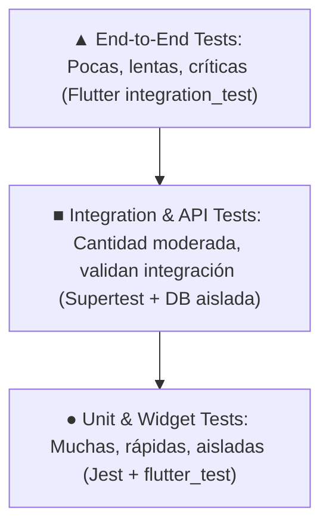

# Plan de Pruebas de Software: Task Manager Application
**Documento de Planificación y Criterios de Aceptación (Sección 1 y 15 de la Guía)**

---

## 1. Plantilla del Plan de Pruebas (Test Plan)

| Campo | Detalle y Especificación |
| :--- | :--- |
| **Feature / Release** | **Task Manager Full Release (v1.0.0)**: API REST Node.js/Express con persistencia PostgreSQL + Aplicación Móvil Flutter con autenticación JWT y refresh tokens. |
| **Alcance (Scope)** | **Incluido:** • Registro y autenticación de usuarios (JWT access token de 15m + refresh token rotativo de 7d). • Gestión de tareas: creación, listado, actualización de título/estado completado y eliminación. • Control de acceso a nivel de objeto (BOLA) y a nivel de propiedad (BOPLA). • Validación de límites en títulos y contraseñas. • Manejo de estados de interfaz móvil (carga, vacío, error con reintento, listado). • Pruebas de rendimiento en endpoint `/health`. **Excluido:** • Pasarela de pagos, notificaciones push nativas en producción, recuperación de contraseñas por SMS. |
| **Riesgos (Risks)** | • **Seguridad:** Fuga de tareas entre usuarios distintos si falla el aislamiento por `ownerId` (BOLA/IDOR). • **Pérdida de datos:** Pérdida de cambios en tareas al suspender la app o perder conectividad. • **Disponibilidad:** Bloqueo del backend por ataques de fuerza bruta en login o payloads JSON sobredimensionados. • **Usabilidad:** Textos truncados o elementos inaccesibles en pantallas pequeñas o con escalado de fuente del 200%. |
| **Entorno de Pruebas (Test Environment)** | • **Backend:** Node.js v24.13.0, Express v4.19.2, Jest v29.7.0, Supertest v7.0.0. • **Base de Datos de Pruebas:** Base de datos aislada con reset automático por suite, garantizando integridad referencial. • **Móvil:** Flutter 3.47.2 / Dart 3.13.2 con suite `flutter_test` e `integration_test`. • **Carga:** Grafana k6 v2.3.0. • **CI:** GitHub Actions Ubuntu runner (Node 22 + Flutter stable). |
| **Datos de Prueba (Test Data)** | Usuarios sintéticos generados dinámicamente (`testuserN_timestamp@example.test`) con contraseñas seguras de prueba (`Password123!`). Nunca se utilizan credenciales reales ni datos de producción. |
| **Tipos de Pruebas (Test Types)** | • Pruebas Unitarias (Jest y flutter_test). • Pruebas de Componentes/Widgets (Flutter). • Pruebas de Integración y API (Supertest). • Pruebas de Viaje de Usuario E2E. • Pruebas Exploratorias basadas en Charter. • Pruebas de Seguridad Negativa y OWASP API Top 10. • Pruebas de Rendimiento y Carga (k6). • Pruebas de Accesibilidad y Compatibilidad de Dispositivos. • Pruebas de Humo (Smoke) y Regresión. |
| **Criterios de Entrada (Entry Criteria)** | • Entorno local configurado con dependencias instaladas (`npm install`, `flutter pub get`). • Base de datos de prueba limpia e independiente. • Documento de requisitos revisado. |
| **Criterios de Salida (Exit Criteria)** | • 100% de las pruebas unitarias y de widgets ejecutadas en verde (0 fallos). • 100% de las pruebas de integración API y seguridad superadas. • Cobertura de código del backend superior al 80%. • Sin vulnerabilidades críticas o altas detectadas en el checklist OWASP. • k6 ejecutado cumpliendo con los umbrales de rendimiento definidos. |
| **Responsables (Owners)** | • QA Lead / Automation Tester: César Garay. • Backend Developer: Node.js Team. • Mobile Developer: Flutter Team. |
| **Evidencias (Evidence)** | Logs de consola reproducibles, salidas de suites de prueba Jest/Flutter/k6 y reportes consolidados en la carpeta `EVIDENCIAS/`. |

---

## 2. Pirámide de Pruebas Aplicada

1. **Base (Unit & Widget Tests):** Prueban `validateTitle`, `validatePassword`, serialización `Task.fromJson` y renderizado de `TaskListPanel` sin dependencias externas.
2. **Capa Media (Integration & API Tests):** Prueban los endpoints de Express (`/api/v1/auth`, `/api/v1/tasks`), verificando autenticación JWT, middleware, serialización HTTP y persistencia en base de datos.
3. **Cúspide (E2E Tests):** Prueban el viaje completo del usuario desde el login visual en Flutter, creación de tarea, completado y logout.

---

## 3. Ejercicio Práctico 1 (Página 3 de la Guía): Criterios de Aceptación

Para el requerimiento: **"Un usuario autenticado puede crear una tarea."**

### Criterio 1: Éxito Típico (Happy Path)
* **Dado** que un usuario ha iniciado sesión correctamente y dispone de un token JWT válido.
* **Cuando** envía una solicitud `POST /api/v1/tasks` con un título válido (ej. `"Revisar flujo de despliegue"` de longitud entre 1 y 120 caracteres).
* **Entonces** el sistema responde con código HTTP `201 Created`, asigna la tarea al `ownerId` del usuario autenticado, genera un identificador único persistente, inicializa `completed: false` y la tarea se refleja inmediatamente en el listado de tareas del usuario.

### Criterio 2: Entrada Inválida (Invalid Input / Negative)
* **Dado** que un usuario autenticado intenta crear una tarea.
* **Cuando** envía un título compuesto únicamente de espacios en blanco (`"   "`), una cadena vacía (`""`), un valor no textual (`null`, `42`) o un título que exceda los 120 caracteres permitidos (ej. 121 caracteres).
* **Entonces** la API rechaza la solicitud con código HTTP `400 Bad Request`, un mensaje de error claro (`"Enter a valid title."`), y no se persiste ningún registro en la base de datos.

### Criterio 3: Límite de Permisos y Autorización (Permission Boundary / Security)
* **Dado** un cliente no autenticado o con un token revocado/expirado, o un usuario malicioso que intenta manipular el campo de propiedad (`ownerId`).
* **Cuando** se realiza la solicitud sin encabezado `Authorization: Bearer <token>`, o incluyendo en el cuerpo JSON un `ownerId` diferente al suyo para intentar crear la tarea en la cuenta de otro usuario.
* **Entonces** el sistema:
  1. Si falta o expira el token: responde de inmediato con HTTP `401 Unauthorized`.
  2. Si se incluye un `ownerId` arbitrario: el backend descarta el campo inyectado o rechaza la solicitud, asociando la tarea de manera estricta y exclusiva al `userId` extraído del token criptográfico del servidor, impidiendo cualquier escalamiento de privilegios o suplantación.

