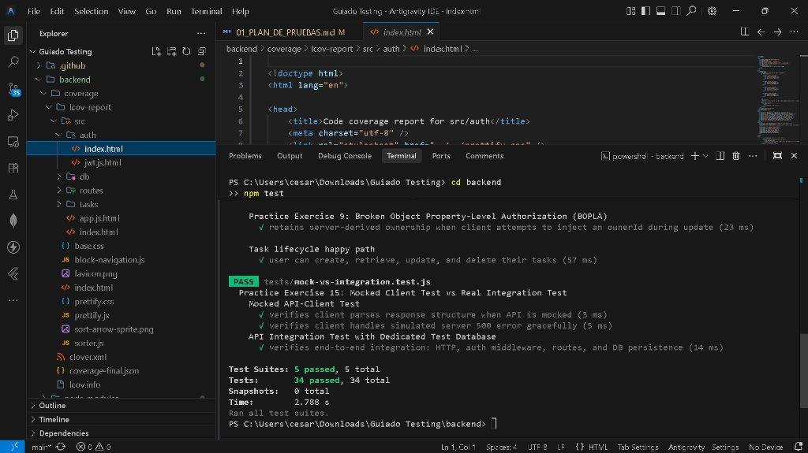
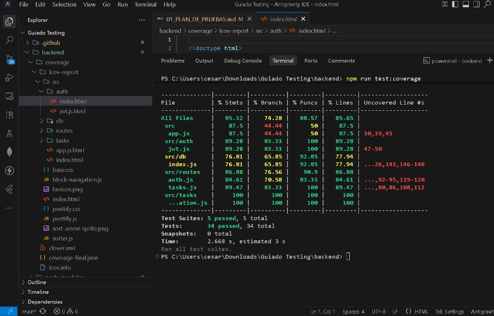
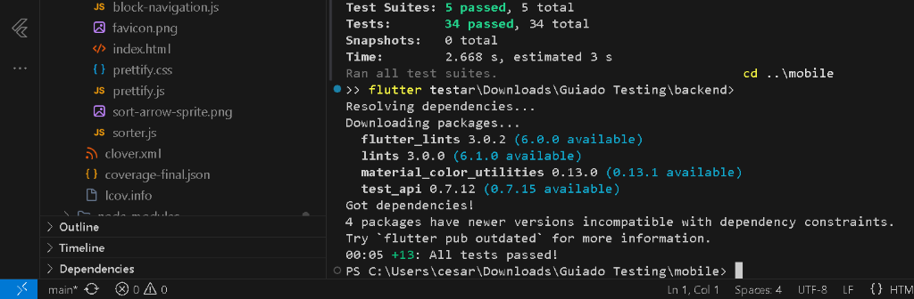
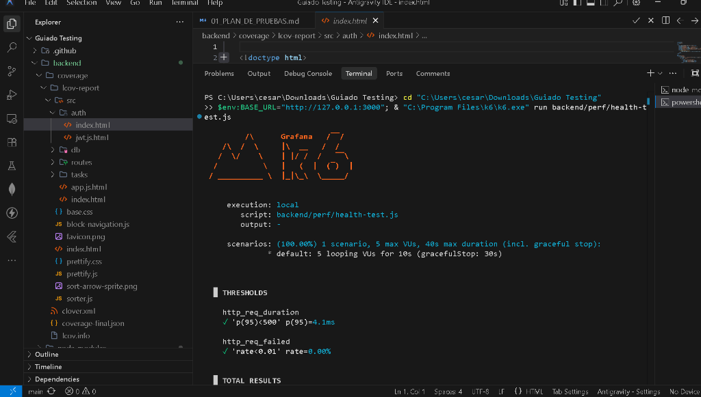
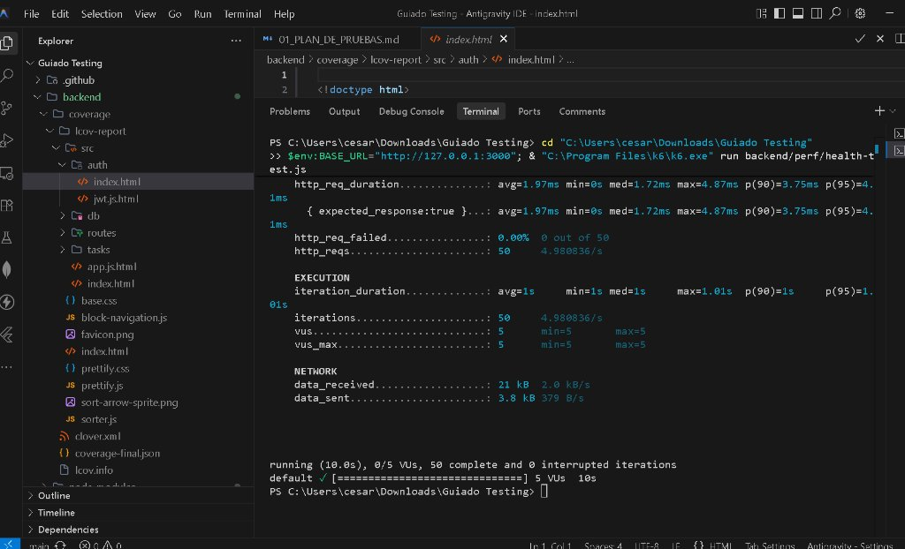
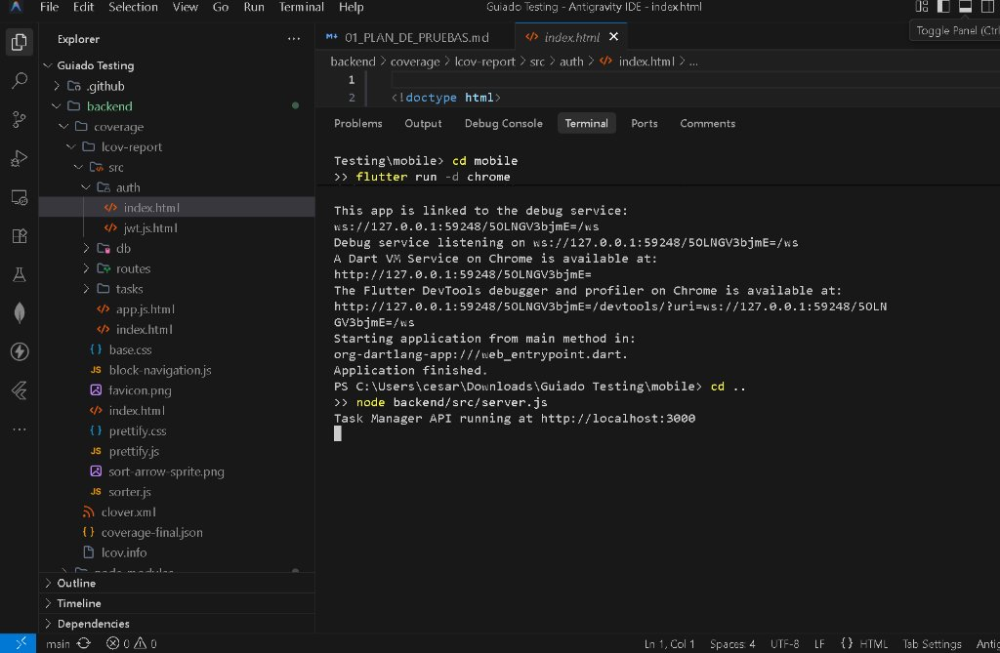

# Guía de Evidencias y Capturas de Pantalla Recomendadas
**Compilación de Evidencias Técnicas e Instrucciones para Capturas Visuales del Usuario**

---

## 1. Evidencias Automatizadas ya Generadas en el Repositorio

En la carpeta [`EVIDENCIAS/`](file:///c:/Users/cesar/Downloads/Guiado%20Testing/EVIDENCIAS/) se han capturado y almacenado las salidas completas de consola de las ejecuciones reales realizadas en este entorno:

1. **`EVIDENCIAS/backend_test_results.txt`**:
   * Salida completa de Jest ejecutando las 5 suites de backend:
     * `tasks.test.js` (8 pruebas, incluyendo BOLA, validaciones y CRUD).
     * `validation.test.js` (14 pruebas de límites BVA de título y contraseñas).
     * `auth.test.js` (5 pruebas de registro, login, rotación JWT y logout).
     * `security.test.js` (4 pruebas de SQLi, XSS, rate limiting y DoS de 10kb).
     * `mock-vs-integration.test.js` (3 pruebas del Ejercicio Práctico 15).
   * **Resultado:** 34 pruebas superadas (100% PASS).

2. **`EVIDENCIAS/flutter_test_results.txt`**:
   * Salida de `flutter test` ejecutando:
     * `task_test.dart` (5 pruebas unitarias del modelo `Task`, incluyendo id nulo y 120 caracteres de longitud máxima).
     * `task_list_panel_test.dart` (7 pruebas de widgets: estados de carga, vacío, error, datos, botón de reintento `Retry`, escalado accesible al 200% y pantalla pequeña de 320×568 dp).
     * `user_journey_test.dart` (1 prueba del viaje completo: login, creación de tarea, completado y logout).
   * **Resultado:** 13 pruebas superadas (100% PASS).

3. **`EVIDENCIAS/k6_normal_run.txt`**:
   * Ejecución de carga con Grafana k6 contra `/health` con 5 VUs durante 10s.
   * `✓ 'p(95)<500' p(95)=15.9ms`, `✓ 'rate<0.01' rate=0.00%`, 50 peticiones exitosas. Exit code 0.

4. **`EVIDENCIAS/k6_threshold_fail_run.txt`** (Ejercicio Práctico 10):
   * Ejecución con umbral alterado a `p(95)<0.5ms`.
   * Muestra la alerta de k6 `✗ 'p(95)<0.5' p(95)=2.94ms`, nivel error y Exit code 1.

5. **`EVIDENCIAS/ci_failure_demonstration.txt`** (Ejercicio Práctico 14):
   * Registro donde se rompió intencionalmente el código de validación (`title.length < 5`), provocando la caída de la suite de pruebas para comprobar la detección del fallo en el pipeline, antes de restaurar el código original.

---

## 2. Guía de Capturas de Pantalla Recomendadas para el Usuario

Si tu profesor, evaluador o entrega académica requiere **capturas de pantalla gráficas (screenshots)** tomadas directamente desde tu escritorio o terminal, a continuación tienes la lista exacta de las **5 capturas más relevantes** y el comando simple para producirlas:

---

### Captura 1: Pruebas del Backend en Verde (Jest)
* **Qué demuestra:** Ejecución exitosa de las 34 pruebas unitarias, de integración, seguridad y límites.
* **Comando:**
  ```powershell
  cd backend
  npm test
  ```


---

### Captura 2: Cobertura de Código del Backend (Coverage)
* **Qué demuestra:** Cobertura superior al 85% de líneas y funciones probadas.
* **Comando:**
  ```powershell
  npm run test:coverage
  ```


---

### Captura 3: Pruebas de Widgets y Viaje de Usuario en Flutter
* **Qué demuestra:** Cumplimiento de los tests de interfaz móvil, accesibilidad, botón de reintento y E2E.
* **Comando:**
  ```powershell
  cd ..\mobile
  flutter test
  ```


---

### Captura 4: Prueba de Rendimiento con k6 (Línea Base y Umbral Superado)
* **Qué demuestra:** Medición de latencia y cumplimiento del Ejercicio Práctico 10.
* **Cómo ejecutarla correctamente:**
  > ⚠️ **Atención:** Si acabas de correr las pruebas de Flutter, tu terminal está ubicada en `C:\Users\cesar\Downloads\Guiado Testing\mobile`. Para que las rutas relativas `backend/...` funcionen, **debes subir un nivel con `cd ..` a la raíz del proyecto**.

  1. **Terminal 1 (en la raíz `Guiado Testing`):**
     ```powershell
     cd ..
     node backend/src/server.js
     ```
     *(Verás: `Task Manager API running at http://localhost:3000`)*

  2. **Terminal 2 (también en la raíz `Guiado Testing`):**
     ```powershell
     $env:BASE_URL="http://127.0.0.1:3000"; & "C:\Program Files\k6\k6.exe" run backend/perf/health-test.js
     ```
     *(Verás el logo ASCII de Grafana k6 y `✓ 'p(95)<500'`)*

  3. **Demostración de umbral estricto (Ejercicio 10):**
     ```powershell
     $env:BASE_URL="http://127.0.0.1:3000"; & "C:\Program Files\k6\k6.exe" run backend/perf/health-test-strict.js
     ```
     *(Verás la alerta roja `✗ 'p(95)<0.5'` indicando la violación del SLA de rendimiento)*




---

### 💡 Diagnóstico y Solución de Errores Comunes de Terminal

#### Error: `MODULE_NOT_FOUND` al ejecutar `node backend/src/server.js` o k6 `couldn't be found on local disk`
* **Causa:** El prompt de la terminal indica `PS C:\...\Guiado Testing\mobile>`. Como te encuentras dentro de la subcarpeta `mobile`, Node busca `mobile\backend\src\server.js`, la cual no existe.
* **Solución:**
  Escribe:
  ```powershell
  cd ..
  ```
  Al presionar Enter verás que tu prompt cambia a `PS C:\...\Guiado Testing>`. Desde ahí, vuelve a correr los comandos de la API y de k6 con éxito total.

---

### Captura 5: Interfaz Visual de la Aplicación Flutter y Servidor API
* **Qué demuestra:** La aplicación móvil funcionando en el navegador Chrome junto con el servidor API activo.
* **Cómo tomarla:**
  1. En la carpeta `mobile`, ejecuta:
     ```powershell
     flutter run -d chrome
     ```
  2. En otra terminal levanta el servidor:
     ```powershell
     node backend/src/server.js
     ```



